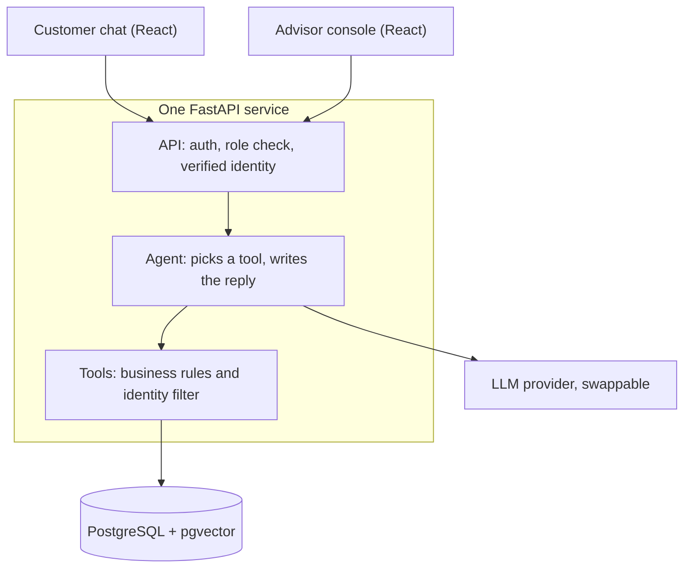

# Customer Support Assistant

An AI customer support assistant for a fictional clothing and shoe shop, in French and English. It answers from policy documents, looks up orders, creates return requests after confirmation, and hands everything else to a human advisor.

> Work in progress: the design is documented, the code is being built.

## What it does

- Answers policy questions with sources (RAG), and says so when the documents do not cover the question.
- Looks up an order or the status of a return or escalated request, read-only.
- Creates a return request, one per item, after a rule check and an explicit confirmation.
- Escalates refunds, exchanges, cancellations and payment problems to a human advisor as a ticket.
- Gives advisors one console with two queues: returns to approve or refuse, and tickets to resolve.

## How it is built

The LLM understands and writes; the code decides and protects. The agent never touches the database: it can only call tools, and the tools apply the business rules and filter every query by the verified customer identity. Only two paths write data: creating a return and creating a ticket.

Full design, flows and data model: [docs/design.md](docs/design.md)

## Tech stack

Python · FastAPI · PostgreSQL + pgvector on Supabase · SQLAlchemy · Alembic · a free LLM API · scikit-learn + MLflow · LangGraph · React + Vite + TypeScript + Tailwind · pytest · DeepEval · Langfuse · Docker · GitHub Actions · Render · Vercel · dbt · Airflow

## Run it locally

Setup instructions will be added once the first version is released.

## Author

Hajer, AI engineer. This is a portfolio project: all data is fictional.
