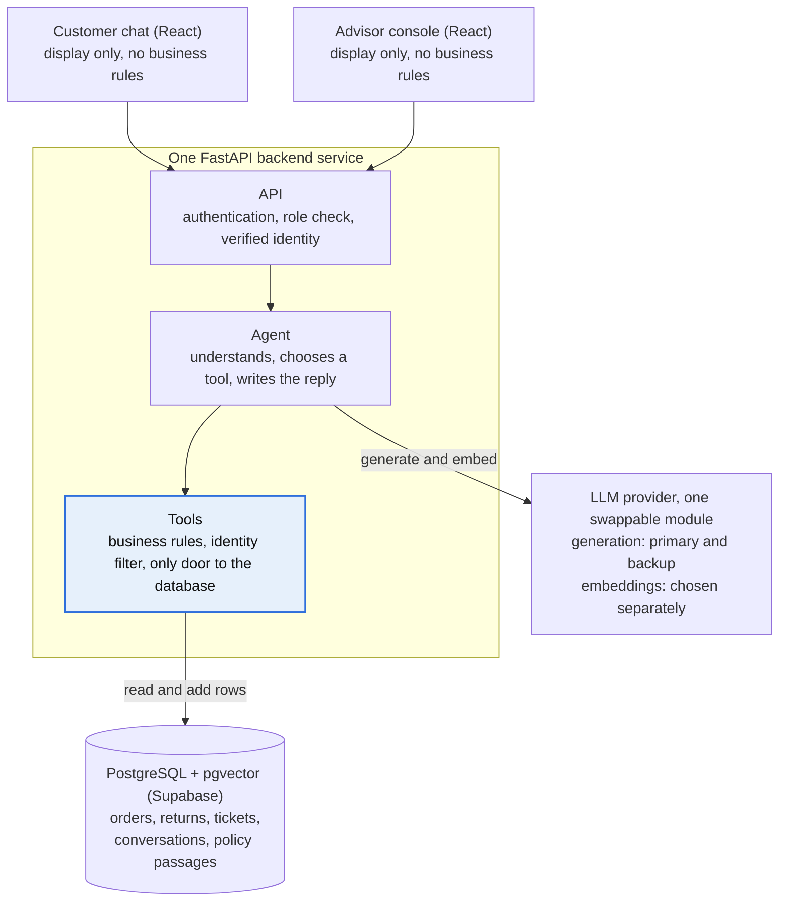
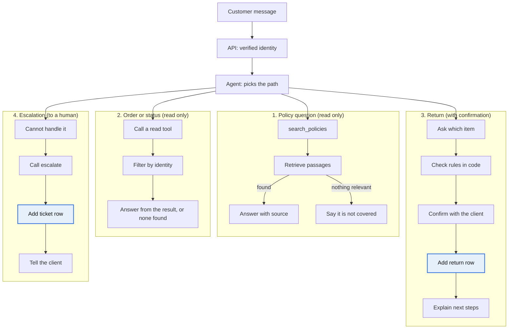
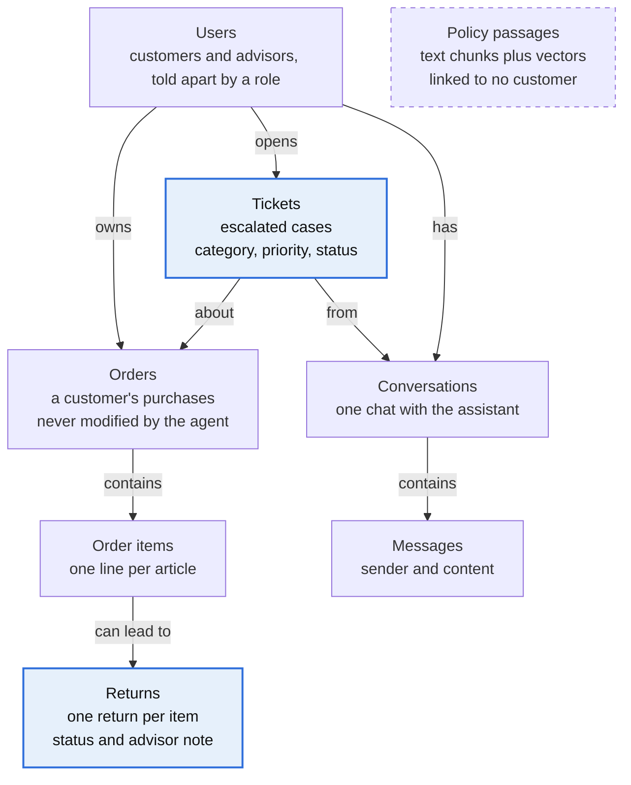

# Design document: customer support assistant

A customer support assistant for a fictional clothing and shoe shop, in French and English. It answers from policy documents, creates returns after confirmation, and escalates everything else to a human.

## Scope

The assistant acts in exactly one case, creating a return, and explains or escalates everything else.

| The assistant does | It escalates as a ticket | It never does |
| --- | --- | --- |
| Answers from policy documents, with sources | Refunds and payment problems | Modify an existing order |
| Looks up an order or the status of a request (read-only) | Exchanges | Move money, ship parcels or update stock |
| Creates a return, one per item, after a rule check and a confirmation | Cancellations and address changes | Let an advisor join the chat live |
| Escalates to an advisor with a ticket | Any request it cannot answer | Answer in other languages (French and English only) |

Advisors work in one console with two queues: returns to approve or refuse, and tickets to resolve with a note.

## Architecture

The agent can only ask. Tools hold the rules and the identity filter, and they are the only code that reads or writes the database. Langfuse traces, DeepEval tests and an MLflow-tracked triage model measure the whole stack.

## Request flows

Only two paths write data: creating a return and creating a ticket (highlighted). A failed rule stops path 3 with an explanation, and a customer who contests a refusal moves to path 4. Statuses of returns and tickets are read through path 2.

## Data model

Highlighted tables receive rows added by tools: returns and tickets. The agent only adds rows and never edits an order. Advisors change only the status and note of a return or a ticket. A refund has no table of its own: its status is the status of its ticket.

## Success criteria

Six measurable targets decide whether the assistant is good enough to ship; thresholds stay provisional until the first measurements in week 2.

| Criterion | Target |
| --- | --- |
| 1. Answer quality (RAG) | At least 80% correct and faithful answers on 60 French and English test questions, with sources, and an explicit "I don't know" when the documents are silent |
| 2. Data security | Zero leaks between customers, including under prompt injection, checked by automated tests |
| 3. Reliable actions | No return without explicit confirmation; return rules respected in 100% of test cases; right tool with right parameters in at least 90% |
| 4. Correct escalation | Refunds, exchanges, cancellations and payment problems escalated in at least 90% of cases, with no needless escalation |
| 5. Ticket triage | Classification score (F1) above a simple baseline; threshold set after the first training |
| 6. Delivery | Public link by the end of week 3, demo video by the end of week 7, tests and evaluation block every deployment, cost of 0 euro |

## Key decisions

Every choice below serves safety or simplicity, and the provider choice stays open until tests in week 2.

| Decision | Choice | Why |
| --- | --- | --- |
| Who acts | The agent only asks; tools execute and filter by the verified identity | The LLM proposes, the code decides, so a manipulated agent cannot reach another customer's data |
| Identity | Order number and email in week 3, then login with Supabase Auth in week 6, behind one "who is this customer?" function | The switch changes one function, not every tool |
| Roles | One login page, redirect by role, role checked on the server for every request | The redirect is comfort; the server check is the protection |
| Returns | One return per item, status `requested` then `approved` or `refused` | Realistic for clothing, where one pullover of three is sent back |
| Escalation | Tickets only for cases the assistant cannot handle; a refused return the customer contests is escalated | No customer is left stuck, and each case has one write path |
| Backend | One FastAPI service with agent, tools and RAG as code modules | Simplest to deploy for free and enough for this volume |
| Agent | Hand-written loop in week 4, LangGraph in week 5 | Understand the mechanism before adopting the framework |
| Vector search | pgvector instead of FAISS | Vectors live next to orders and tickets and filter in SQL; speed does not matter at this size |
| LLM and embeddings | A primary and a backup generation provider (Mistral and Groq to start); embeddings chosen separately | Free-tier limits change, so the final choice is measured on the same test questions in week 2 |
| Languages | French and English only | Two languages keep the 60-question evaluation reliable on free models |
